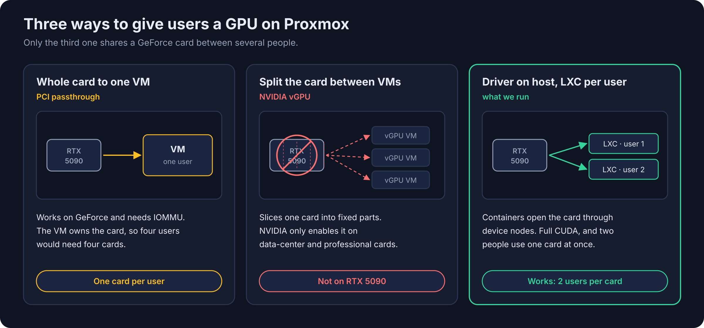

## Introduction

We have a server with two GeForce RTX 5090 cards and four people who want to run models on them.
A card per person would mean twice the hardware, and a single shared login would mean everyone shares files, packages and GPU memory with no limits.

The usual answer for splitting a GPU between virtual machines is NVIDIA vGPU, but NVIDIA only enables vGPU on data-center and professional cards.
A 5090 can't be sliced that way.
What a GeForce card can do is let several processes use it at once, so we moved the split from the hardware to the operating system:
the NVIDIA driver runs on the Proxmox host, each user gets their own unprivileged LXC container, and each container is allowed to open exactly one card.

This setup is running on our server now, and it works.
Each card serves two users at the same time with full CUDA, everyone has their own root account and filesystem, and a small watchdog on the host keeps anyone from taking more than their share of VRAM.

## Why LXC containers



Proxmox gives you three options for putting a GPU in front of users.
PCI passthrough hands a whole card to one VM. It works on GeForce, but the VM owns the card, so four users would need four cards.
vGPU would split a card between VMs with fixed memory slices, and that's exactly the feature GeForce doesn't get.

The third option skips VMs.
Containers on Proxmox share the host's kernel, so if the host loads the NVIDIA driver, a container only needs access to the card's device file to use it.
Two containers can open the same device file at the same time, the same way two programs on one machine can share a GPU.

## The setup at a glance


| Container | Hostname  | Card  | Device node    | Proxmox login | VRAM quota |
| --------- | --------- | ----- | -------------- | ------------- | ---------- |
| 101       | gpu-user1 | GPU 0 | `/dev/nvidia0` | `user1@pve`   | 16,000 MiB |
| 102       | gpu-user2 | GPU 0 | `/dev/nvidia0` | `user2@pve`   | 16,000 MiB |
| 103       | gpu-user3 | GPU 1 | `/dev/nvidia1` | `user3@pve`   | 16,000 MiB |
| 104       | gpu-user4 | GPU 1 | `/dev/nvidia1` | `user4@pve`   | 16,000 MiB |

A 5090 reports about 32,600 MiB, so two 16,000 MiB quotas leave a little headroom on each card.
The IDs and names are examples; pick whatever suits you.

### What you get, and what you give up

Each user has their own root account, filesystem, IP address and SSH access, and can't see anyone else's files or processes.
Two users can work on the same card at once, and from inside the container it behaves like a normal Linux box with a GPU: they install llama.cpp, vLLM, Ollama or PyTorch the usual way.

There are trade-offs, and you should know them before you start:

- The driver doesn't divide VRAM between containers. We added that ourselves with a watchdog, covered below.
- Containers share the host kernel. That's fine for colleagues, but it's weaker isolation than a VM. We wouldn't use this for tenants who don't trust each other.
- Every container has to run the same NVIDIA driver version as the host, so driver upgrades happen everywhere at once.

## Preparing the host

Two firmware settings matter.
Turn on Above 4G Decoding so both 32 GB cards can be mapped, and turn off Secure Boot, because otherwise the NVIDIA kernel module has to be signed with a key you enroll yourself.
IOMMU isn't needed, since no card is passed through to a VM.

After a standard Proxmox VE 9 install (without a subscription, switch to the no-subscription repository first) and a full upgrade, `lspci -nn | grep -i nvidia` should show both cards.

The driver goes on the host.
The RTX 50 series needs driver branch 570 or newer, and it needs the open kernel modules.
The older proprietary modules don't support these cards, and with them the host reports "No devices were found".

```bash
apt install -y build-essential dkms pciutils wget \
    proxmox-default-headers proxmox-headers-$(uname -r)

# keep nouveau away from the cards
cat > /etc/modprobe.d/blacklist-nouveau.conf <<'EOF'
blacklist nouveau
options nouveau modeset=0
EOF
update-initramfs -u -k all && reboot

# then install the driver from nvidia.com with DKMS and the open modules
./NVIDIA-Linux-x86_64-$VER.run --dkms --kernel-module-type=open
nvidia-smi
```

Keep the `.run` file.
The same file goes into every container later.
`--dkms` rebuilds the module when the kernel updates, and `proxmox-default-headers` makes sure the headers for new kernels get installed so that rebuild can happen.

## Making the device nodes exist at boot


This step is easy to miss because everything works until the first reboot.
The `/dev/nvidia*` files only appear once something uses the driver.
Proxmox starts containers early in boot, and if the files aren't there yet, a container refuses to start with `Device /dev/nvidia1 does not exist`.

The fix is a one-shot service that touches the driver before Proxmox starts any guests:

```ini
# /etc/systemd/system/nvidia-dev-nodes.service
[Unit]
Description=Create NVIDIA device nodes before guests start
After=systemd-modules-load.service
Before=pve-guests.service

[Service]
Type=oneshot
RemainAfterExit=yes
ExecStart=/usr/bin/nvidia-smi
ExecStart=/usr/bin/nvidia-modprobe -u -c=0

[Install]
WantedBy=multi-user.target
```

Together with `nvidia` and `nvidia_uvm` listed in `/etc/modules-load.d/nvidia.conf`, this gives you `nvidia0`, `nvidia1`, `nvidiactl`, `nvidia-uvm` and `nvidia-uvm-tools` on every boot.

One more thing to check once: the index `nvidia-smi` shows for a card doesn't always match the number in `/dev/nvidiaN`.
Look up the real mapping under `/proc/driver/nvidia/gpus/*/information` (the "Device Minor" line) and compare it with the PCI bus IDs from `nvidia-smi` before you hand out cards.

## Giving each container one card


The four containers are unprivileged Ubuntu 24.04 containers with nesting turned on (Debian 13 works too).
Size them to your server; 8 cores, 32 GiB of RAM, no swap and 200 GiB of disk for model files is a reasonable start.
Then each one gets four device entries.
Three are the same everywhere; only the first one decides which card the container can open.

```bash
# card 0 -> containers 101 and 102
for ct in 101 102; do
  pct set $ct --dev0 /dev/nvidia0 --dev1 /dev/nvidiactl \
              --dev2 /dev/nvidia-uvm --dev3 /dev/nvidia-uvm-tools
done

# card 1 -> containers 103 and 104
for ct in 103 104; do
  pct set $ct --dev0 /dev/nvidia1 --dev1 /dev/nvidiactl \
              --dev2 /dev/nvidia-uvm --dev3 /dev/nvidia-uvm-tools
done
```

Don't skip the `nvidia-uvm` entries.
Without them `nvidia-smi` works inside the container, which looks like success, but CUDA programs fail to start.
By default only root in the container can open these files; if users run services under another account, add `mode=0666` to each entry.

The containers use the host's kernel module, so inside them you install only the user-space half of the same driver:

```bash
for ct in 101 102 103 104; do
  pct push $ct /root/NVIDIA-Linux-x86_64-$VER.run /root/nvidia.run --perms 755
  pct exec $ct -- /root/nvidia.run --no-kernel-modules --silent
  pct exec $ct -- nvidia-smi
done
```

Each container should now list exactly one RTX 5090.
The process table at the bottom of `nvidia-smi` stays empty inside a container, which is normal.
To test the pinning, load a model in container 101 while watching `nvidia-smi` on the host. Memory should rise on card 0 and nowhere else.

## Watching VRAM

The Proxmox summary pages show CPU, memory, disk and network, but nothing about the GPU.
On the host, `nvidia-smi`, `watch -n 2 nvidia-smi` and `nvtop` cover the live view.
For history, a one-line cron job appends `memory.used` and `utilization.gpu` for each card to a CSV every minute, with weekly log rotation.
If you want Grafana dashboards, `nvidia_gpu_exporter` wraps `nvidia-smi` and works with GeForce cards.

None of these tools show which container is using the memory.
The host can see every GPU process, though, and each process's cgroup path contains the ID of the container it runs in.
Our `vram-guard` tool adds that up:

```text
$ vram-guard status
CT     NAME             USED_MiB  LIMIT_MiB STATE
101    gpu-user1           18000      16000 OVER
102    gpu-user2               0      16000 ok
103    gpu-user3           15000      16000 ok
104    gpu-user4            9200      16000 ok
```

Inside a container, users see the total memory in use on their card, including their neighbor's share, but not who is using it or with what.

## Enforcing VRAM quotas

The GeForce driver has no way to cap memory per container, so a user who loads a model that's too big can starve the other person on the same card.
We handle that with a watchdog on the host.


Every two seconds, `vram-guard` reads per-process VRAM from `nvidia-smi`, maps each process to its container and sums the usage per container.
If a container goes over its quota, the guard ends that container's largest GPU process and writes down why, both in the host journal and in `/var/log/vram-quota.log` inside the container, so the user isn't left guessing.
The container itself keeps running.

The quotas live in a plain file that's re-read on every pass, so changing a limit doesn't need a restart:

```text
# /etc/vram-quota.conf
# CTID  limit in MiB
101 16000
102 16000
103 16000
104 16000
```

The guard runs as a systemd service (`Restart=always`, started after `nvidia-dev-nodes`).
The full script is at the end of this post.

### What a quota hit looks like


The user whose job was ended finds a line like this in the container:

```text
2026-11-11 14:02:31 VRAM quota exceeded: container 101 used 18000 MiB, limit 16000 MiB.
    Ended python (PID 4242 in container, 12000 MiB).
```

A few things to know about how this behaves:

- The program is ended from outside. It gets SIGTERM and then SIGKILL, not an out-of-memory exception it could catch.
- It reacts after the fact. A job can sit over its quota for up to one check interval, and if the card is completely full during that moment, the neighbor's allocation can fail. Keeping both quotas below the card's total, as in the bar above, makes that much less likely.
- Only processes holding GPU memory are touched. A process that uses both cards counts against both.

If users want their own code to fail cleanly before the watchdog steps in, they can set a cap just under their quota:

| Stack     | Setting                                                                               |
| --------- | ------------------------------------------------------------------------------------- |
| PyTorch   | `torch.cuda.set_per_process_memory_fraction(0.48)` raises a CUDA out-of-memory error. |
| vLLM      | `--gpu-memory-utilization 0.45` limits what the server reserves.                      |
| llama.cpp | Pick the quantization, context size and `-ngl` layer count so the model fits.         |

These caps are voluntary, so we keep the watchdog as the backstop.
For vLLM in particular, remember that the KV cache takes whatever the utilization setting leaves after the weights, so a lower cap mostly means fewer concurrent requests.
If you run vLLM in these containers, the [vLLM metrics post](/post/ai/deep-dive-into-vllm-inference-metrics) covers how to watch that from the inside.

## Users and the Proxmox web UI


Each user also gets a Proxmox login that shows only their own container.
They can start, stop and reboot it, open its console and take backups.
They can't change its hardware, so the GPU device entries stay the way we set them, and the other three containers don't appear in their tree at all.

```bash
for i in 1 2 3 4; do
  pveum user add user$i@pve --comment "GPU user $i"
  pveum passwd user$i@pve
  pveum acl modify /vms/10$i --users user$i@pve --roles PVEVMUser
done
```

For the administrator, two pools (`gpu0` and `gpu1`) and tags like `gpu0;user1` make it easy to see who sits on which card.
Switching the tree to Pool View groups the containers by card, and Datacenter → Search with `gpu0` in the filter gives a quick table.
From the shell, `grep -H '^dev' /etc/pve/lxc/10[1-4].conf` shows the card pinning for all four at once.

## How we know it works

After the setup, we went through these checks, and all of them pass on our server:

| Check                              | Result                                                         |
| ---------------------------------- | -------------------------------------------------------------- |
| `nvidia-smi` on the host           | Both RTX 5090 cards listed.                                    |
| `nvidia-smi` in each container     | One RTX 5090, no version error.                                |
| Load a model in container 101      | Memory rises on card 0 only.                                   |
| Reboot the host                    | All four containers start on their own and still see a card.   |
| Log in as `user1@pve`              | Only container 101 is visible.                                 |
| Go over a quota on purpose         | The job is ended within seconds and the reason is logged.      |
| `vram-guard status`                | All four containers listed with their quotas.                  |

If you build this yourself, do the quota test on your own hardware before you rely on it: start a job that's deliberately too large and confirm it gets ended and logged.

## Living with it

### Kernel updates

DKMS rebuilds the NVIDIA module for each new kernel, but a new Proxmox kernel can be ahead of what the driver supports, and people have reported build failures on newer kernel headers.
After every kernel update we reboot and run `nvidia-smi`.
If it fails, boot the previous kernel and pin it with `proxmox-boot-tool kernel pin` until a fixed driver comes out.

### Driver upgrades

The host and all four containers change together.
Stop the containers, install the new driver on the host, then push the same `.run` file into each container again.
If you forget a container, it tells you with "Driver/library version mismatch".

### Adding a user

Create a container, attach a card, install the user-space driver, add a quota line and create the login.
Keep to two users per card, or lower the quotas so they still add up to less than the card.

### Common problems

| Symptom                                       | Likely cause                                                                         |
| --------------------------------------------- | ------------------------------------------------------------------------------------ |
| Container won't start, device does not exist  | Device nodes weren't created at boot. Check the `nvidia-dev-nodes` service.          |
| Host says "No devices were found"             | Proprietary modules were installed. Reinstall with `--kernel-module-type=open`.      |
| Module won't load after install               | Secure Boot is on, or nouveau is still loaded.                                       |
| "Driver/library version mismatch" in a CT     | The container's driver version differs from the host's.                              |
| `nvidia-smi` works but CUDA fails in a CT     | `/dev/nvidia-uvm` is missing from the container's device entries.                    |
| Container sees the wrong card                 | The `/dev/nvidiaN` number doesn't match the card you expected. Redo the mapping.     |
| Out of memory while under quota               | The neighbor is over theirs, or the quotas add up to more than the card holds.      |

## The vram-guard script

Save it as `/usr/local/bin/vram-guard` on the host, `chmod +x` it, and run `vram-guard run` from a systemd unit.
`vram-guard status` prints the table shown earlier.

```bash
#!/bin/bash
# vram-guard - VRAM report and quota enforcement for Proxmox LXC containers.
# Run on the Proxmox host as root.
#   vram-guard status   one-off table of VRAM used per container
#   vram-guard run      loop forever; end GPU tasks of containers over quota

CONF=/etc/vram-quota.conf       # one line per container: <CTID> <limit in MiB>
INTERVAL=2                      # seconds between checks
GRACE=5                         # seconds between SIGTERM and SIGKILL

declare -A LIMIT

load_conf() {
  LIMIT=()
  [ -r "$CONF" ] || return 0
  while read -r ct lim _; do
    [[ $ct =~ ^[0-9]+$ && $lim =~ ^[0-9]+$ ]] && LIMIT[$ct]=$lim
  done < "$CONF"
}

# Prints "<ct> <host pid> <MiB>" for every process holding GPU memory.
scan() {
  nvidia-smi --query-compute-apps=pid,used_memory \
             --format=csv,noheader,nounits |
  while IFS=', ' read -r pid mem; do
    [[ $pid =~ ^[0-9]+$ && $mem =~ ^[0-9]+$ ]] || continue
    ct=$(grep -oP '/lxc/\K[0-9]+' "/proc/$pid/cgroup" 2>/dev/null | head -n1)
    echo "${ct:-host} $pid $mem"
  done
}

status() {
  load_conf
  declare -A used
  local ct pid mem lim name state
  while read -r ct pid mem; do
    [ -n "$ct" ] && used[$ct]=$(( ${used[$ct]:-0} + mem ))
  done < <(scan)
  printf '%-6s %-16s %9s %10s %s\n' CT NAME USED_MiB LIMIT_MiB STATE
  for ct in $(printf '%s\n' "${!LIMIT[@]}" "${!used[@]}" | sort -u); do
    [ -z "$ct" ] && continue
    name=-
    [ "$ct" != host ] && name=$(pct config "$ct" 2>/dev/null |
                                 awk '/^hostname:/{print $2}')
    lim=${LIMIT[$ct]:--}
    state=ok
    [ "$lim" != - ] && [ "${used[$ct]:-0}" -gt "$lim" ] && state=OVER
    printf '%-6s %-16s %9s %10s %s\n' \
           "$ct" "${name:--}" "${used[$ct]:-0}" "$lim" "$state"
  done
  echo
  nvidia-smi --query-gpu=index,name,memory.used,memory.total \
             --format=csv,noheader
}

enforce() {
  declare -A used
  local rows ct pid mem lim inpid comm msg i
  rows=$(scan)
  while read -r ct pid mem; do
    [ -n "$ct" ] && used[$ct]=$(( ${used[$ct]:-0} + mem ))
  done <<< "$rows"

  for ct in "${!used[@]}"; do
    lim=${LIMIT[$ct]:-}
    [ -z "$lim" ] && continue                 # no quota set for this one
    [ "${used[$ct]}" -le "$lim" ] && continue # within quota

    # Pick the largest GPU process in this container.
    read -r _ pid mem < <(awk -v c="$ct" '$1==c' <<< "$rows" |
                          sort -k3,3nr | head -n1)
    inpid=$(awk '/^NSpid:/{print $NF}' "/proc/$pid/status" 2>/dev/null)
    comm=$(cat "/proc/$pid/comm" 2>/dev/null)
    msg="VRAM quota exceeded: container $ct used ${used[$ct]} MiB, limit $lim MiB."
    msg="$msg Ended ${comm:-process} (PID ${inpid:-?} in container, $mem MiB)."

    logger -t vram-guard "$msg"
    timeout 5 pct exec "$ct" -- sh -c 'echo "$0" >> /var/log/vram-quota.log' \
            "$(date '+%F %T') $msg" 2>/dev/null

    kill -TERM "$pid" 2>/dev/null
    for i in $(seq "$GRACE"); do
      kill -0 "$pid" 2>/dev/null || break
      sleep 1
    done
    kill -KILL "$pid" 2>/dev/null
  done
}

case "$1" in
  status) status ;;
  run)    while true; do load_conf; enforce; sleep "$INTERVAL"; done ;;
  *)      echo "usage: vram-guard status|run" >&2; exit 1 ;;
esac
```

And the unit that keeps it running:

```ini
# /etc/systemd/system/vram-guard.service
[Unit]
Description=VRAM quota guard for LXC containers
After=nvidia-dev-nodes.service

[Service]
ExecStart=/usr/local/bin/vram-guard run
Restart=always
RestartSec=5

[Install]
WantedBy=multi-user.target
```

## References

- [Proxmox VE container configuration, `dev[n]` device passthrough](https://pve.proxmox.com/wiki/Manual:_pct.conf)
- [Proxmox VE user management: roles, paths and pools](https://pve.proxmox.com/wiki/User_Management)
- [Proxmox forum: LXC GPU passthrough guide with Proxmox VE 9.2 notes](https://forum.proxmox.com/threads/183835)
- [Proxmox forum: GPU passthrough to an unprivileged container](https://forum.proxmox.com/threads/181955)
- [NVIDIA developer forum: driver build failure on newer Proxmox kernel headers](https://forums.developer.nvidia.com/t/385464)
- [NVIDIA driver downloads](https://www.nvidia.com/drivers)
